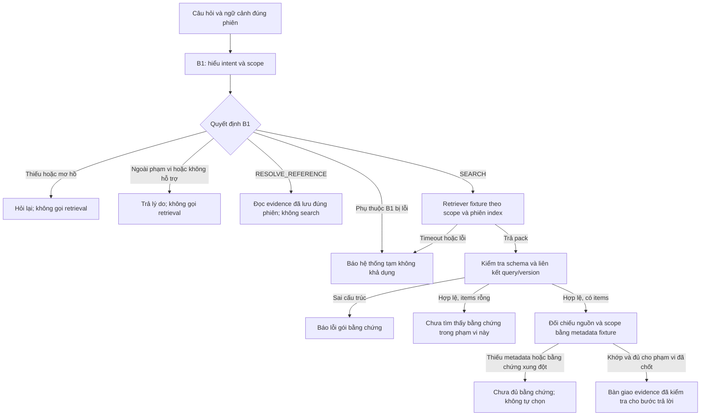

# Luồng retrieval bằng fixture và xử lý thông tin mơ hồ

Trạng thái: phân tích trước triển khai. Chưa có code chức năng, endpoint hoặc kết quả chạy test nghiệp vụ. Các interface, trạng thái đầu ra và cấu trúc thư mục bên dưới là đề xuất để thảo luận, không phải contract đã được team ký duyệt.

Đầu vào đã đọc:

- `S3-WBS03_intent_scope_B1 (1).md`: B1 hiểu câu hỏi và quyết định tìm kiếm/hỏi lại/từ chối/truy nguồn.
- `S3-WBS08_Evidence_Pack_DeXuat.md`: cấu trúc gói bằng chứng đề xuất v1 và quy tắc parser/consumer.

## 1. Hai việc ghép với nhau thế nào?

**Orchestration là bộ điều phối:** gọi đúng bước, đúng thứ tự, đưa dữ liệu qua các bước và trả trạng thái có cấu trúc. Fixture thay dịch vụ tìm kiếm thật bằng dữ liệu cố định để kiểm tra luồng.

**Ambiguity handling là các quy tắc dừng/chuyển nhánh:** thiếu thông tin thì hỏi lại; đủ thông tin nhưng không có bằng chứng thì báo thiếu; dịch vụ lỗi thì báo lỗi tạm thời. Không phải một bộ trả lời thứ hai chạy sau toàn bộ orchestration.

Sơ đồ là thiết kế đề xuất. `SEARCH` là quyết định của B1, không phải bằng chứng rằng tìm kiếm thành công. Bước cuối chưa đồng nghĩa đã sinh đáp án tài chính hoặc citation mở được nguồn thật.

## 2. Những ranh giới đã có trong hai tài liệu

| Lớp | Trách nhiệm | Không được làm |
|---|---|---|
| B1 | Nhận intent; xác định công ty, kỳ, chỉ tiêu/chủ đề, basis, entity và nguồn; phát quyết định | Tự tạo số, evidence; đoán công ty/kỳ/metric; khẳng định corpus có dữ liệu |
| Orchestrator | Gọi đúng adapter theo decision, áp timeout, gom kết quả theo schema phản hồi | Search khi B1 chưa cho phép; biến timeout thành NO_DATA |
| Retriever fixture | Trả kết quả cố định tương ứng scope/version hoặc lỗi giả lập | Gọi vector/LLM thật; chọn fixture gần giống khi scope không khớp |
| Evidence parser | Kiểm tra các trường bắt buộc, kiểu, ID trùng, locator, hash, score và version | Bù metadata thiếu; tự bỏ item sai rồi dùng phần còn lại |
| Evidence gate/resolver fixture | Đối chiếu query/version và registry fixture; đánh giá phù hợp phạm vi | Coi cosine cao là đáp án đúng; tự giải quyết số liệu mâu thuẫn |
| Reference handler | Đọc answer/evidence đã lưu của đúng phiên | Search lại để tạo citation thay thế; dùng evidence phiên khác |

Baseline nhận diện nhưng tắt News; có 10 ticker trong đặc tả. Thiếu coverage không phải thiếu slot. Một lượt có nhiều yêu cầu độc lập phải yêu cầu tách, không chạy một nửa. Context chỉ được kế thừa khi có chỉ dẫn và ứng viên duy nhất còn hiệu lực.

## 3. Khoảng trống cần xử lý trước khi nối luồng

### Gói bằng chứng đúng JSON chưa chắc đúng câu hỏi

Pack v1 có `source_type`, passage, locator và định danh/version, nhưng chưa khai báo các trường ngữ nghĩa như ticker, kỳ tài chính, metric, basis, đơn vị và reporting entity. Vì vậy parser v1 không đủ để chứng minh một đoạn trả lời đúng scope.

**Đề xuất cho giai đoạn fixture:** thêm registry fixture riêng, tra bằng `(index_version, chunk_id)` và đối chiếu cả nguồn/hash/locator. Registry giữ scope và metadata có nhãn giả lập. Giữ nguyên hai tài liệu nguồn; không âm thầm sửa pack v1 thành contract mới. Về sau adapter metadata thật thay registry giả lập. Có thể chọn mở rộng pack thay sidecar, nhưng cần ghi rõ quyết định hợp đồng.

- Hỏi BID, registry cho VCB: từ chối dùng bằng chứng đó, dù score cao.
- Hỏi ngày 30/06, nguồn là ngày 31/12: không dùng thay thế.
- Hỏi riêng quý nhưng nguồn YTD: không tự cộng/trừ hay đổi basis.
- Metadata entity/đơn vị thiếu: báo chưa đủ thông tin nguồn để xác minh; không tự mặc định hợp nhất/triệu VND.
- Hai nguồn cùng scope nhưng giá trị khác: không tự chọn theo score nếu chưa có chính sách nguồn/phiên bản được duyệt.

Đối với bảng có nhiều cột năm/chỉ tiêu, metadata cấp tài liệu chưa đủ: binding phải đến đúng dòng/cột/header/đơn vị hoặc record JSON tương ứng. Với compare/trend, gate phải kiểm tra đủ mọi công ty × mọi kỳ yêu cầu; không âm thầm trả kết quả một phần. Resolver fixture kiểm tra được các quan hệ mô phỏng này, chưa chứng minh chúng đúng trong PDF/JSON thật.

Mẫu hợp lệ WBS08 hiện là nội dung **BCTN quản trị**, không phải bằng chứng cho ví dụ **tổng tài sản BID/BCTC**. Cần fixture BCTC riêng để thử luồng metric; dữ liệu đó phải được đánh dấu giả lập rõ, không trình bày như số liệu BID thật.

### Đầu vào B1 và đầu ra toàn luồng còn cần chốt

- WBS03 đặc tả B1, chưa chứng minh có analyzer đang chạy. WBS13 có thể inject một analyzer fixture để thử điều phối trước. Cách đó không chứng minh hệ thống hiểu câu hỏi tự nhiên bất kỳ.
- Nếu WBS18 cần tự nhận biết câu hỏi thiếu/mơ hồ, phải có scope gate/analyzer thực thi cho phạm vi ngôn ngữ đã chọn và test tương ứng; không chỉ viết sẵn chuỗi thông báo.
- Hai tài liệu chưa cung cấp schema phản hồi thống nhất cho toàn orchestration, timeout/deadline, trạng thái đủ bằng chứng và chính sách mâu thuẫn nguồn.
- `corpus_version_id` phía B1 và `data_version.kind=INDEX` phía pack cần adapter/resolver rõ. Không mặc định hai ID là một, không tự chọn `latest`.
- Cần quy tắc liên kết request với `query_id`; hash đúng định dạng chưa chứng minh nguồn tồn tại. Registry fixture chỉ chứng minh mô phỏng resolver.
- ID evidence mới được yêu cầu duy nhất trong một pack, chưa chắc duy nhất toàn hệ thống. Reference nên tra theo session/answer/query/pack/evidence đã liên kết, không chỉ một chuỗi evidence ID.
- Cần bảng ưu tiên decision cụ thể: ca B1-40 “tổng tài sản ... theo tin tức” yêu cầu hỏi lại nguồn BCTC (`SOURCE_CONFLICT`), khác câu hỏi News thuần bị từ chối. Xung đột giữa hai evidence tài chính cũng cần reason riêng, không dùng lẫn `SOURCE_CONFLICT`.

## 4. Các tình huống người dùng sẽ thấy

| Tình huống | Hành động | Gọi retrieval? |
|---|---|---|
| “Tổng tài sản năm 2025?” | Hỏi công ty nào; giữ metric và kỳ đã rõ | Không |
| “Lợi nhuận BID quý 2/2026?” | Hỏi trước hay sau thuế; không hỏi lại BID/kỳ | Không |
| Người dùng trả lời “sau thuế” trong đúng lượt làm rõ | Ghép slot mới với BID/kỳ đã xác nhận, chạy lại gate | Chỉ khi đủ scope |
| “Tổng tài sản BID tại 30/06/2026?” và fixture khớp | Trả trạng thái evidence sẵn sàng cùng scope/provenance giả lập | Có, một lần cho thử nghiệm đơn giản |
| Câu hỏi đủ, pack hợp lệ có `items: []` | “Chưa tìm thấy bằng chứng phù hợp trong phạm vi này.” | Có |
| Pack có đoạn VCB trong câu hỏi BID | Báo evidence không khớp/không đủ; không trả số VCB | Có |
| Pack thiếu locator/version | Báo lỗi dữ liệu/gói bằng chứng, không bắt người dùng sửa câu hỏi | Có |
| Dịch vụ tìm kiếm timeout | “Dịch vụ tìm kiếm tạm thời không phản hồi. Vui lòng thử lại.” | Có; kết quả muộn không được ghi đè |
| “Nguồn số vừa trả lời ở đâu?” có reference đúng phiên | Tra kho reference fixture | Không; gọi reference handler |
| Hỏi News ở baseline | Báo loại nguồn chưa bật, không lén chuyển sang BCTC | Không |

Không dùng `ASK_CLARIFICATION` cho lỗi metadata kỹ thuật. Chỉ hỏi người dùng khi họ thực sự có thể làm rõ ý định/phạm vi (ví dụ hợp nhất hay riêng), không yêu cầu họ sửa index hoặc đoán source ID.

## 5. Interface và trạng thái đề xuất

Các tên dưới đây chưa phải API đã có. Chưa cần FastAPI, DB, giao diện, embedding hoặc vector thật để thử cxác interface này.

- `analyzer.analyze(question, session_context) -> B1Decision`
- `orchestrator.run(request) -> OrchestrationResult`
- `retriever.retrieve(resolved_scope, pinned_index, query_id, deadline) -> EvidencePack`
- `pack_validator.validate(pack) -> errors`
- `evidence_gate.check(pack, resolved_scope, registry) -> EvidenceCheck`
- `reference_resolver.resolve(reference, session_context) -> ReferenceResult`

Đề xuất `OrchestrationResult` giữ riêng `b1_decision` với `status`, `reason_code`, `message`, `resolved_scope`, `clarification`, `evidence_pack`, `execution_mode=FIXTURE` và trace tối thiểu. Payload theo từng status phải có quy tắc rõ; nhánh lỗi không kèm đáp án/số/citation trông như đã xác minh.

Nhóm trạng thái cần phân biệt: hỏi lại; ngoài phạm vi/không hỗ trợ; không có kết quả (`NO_DATA` đã được tài liệu nhắc); pack sai (`INVALID_EVIDENCE_PACK` đã được đề xuất); bằng chứng không đủ/không khớp/xung đột; hệ thống tạm lỗi; evidence đã sẵn sàng; reference được tìm thấy hoặc không xác minh được. Tên enum mới như `EVIDENCE_READY`, `INSUFFICIENT_EVIDENCE` là **đề xuất**, không tự thêm vào enum decision B1.

## 6. Thứ tự làm để hai việc không chờ nhau

1. Chốt schema phản hồi toàn luồng và quy tắc query/index linkage. Lập bản đồ trạng thái đã có và trạng thái mới đề xuất.
2. Tạo fixtures cố định: B1 đầy đủ/mơ hồ, registry alias/scope/index, pack đúng/sai/rỗng/xung đột, reference đúng/sai phiên. Gắn nhãn fixture ngay trong dữ liệu/thông báo thử nghiệm.
3. Dựng orchestration với adapter inject được. Test đường `SEARCH`, dừng đúng nhánh khác, timeout và kiểm tra pack. Chưa gọi nguồn ngoài.
4. Dựng ambiguity gate và lượt bổ sung slot; test không tự chọn metric/kỳ/company/entity, giữ slot đã rõ và cách ly session.
5. Ghép hai phần bằng cùng bộ fixture, đối chiếu decision/reason/scope/call counts. Bổ sung từng intent baseline đã chốt thay vì tuyên bố chỉ một câu metric là hoàn tất toàn B1.
6. Khi vector thật sẵn sàng, thay adapter và chạy bộ contract/integration test mới; fixture pass không chứng minh retrieval thật hay citation thật chính xác.

Vòng đầu có thể bắt đầu với một câu `FINANCIAL_METRIC` xuyên suốt để kiểm tra khung, rồi thêm trend/compare/BCTN/reference và các nhánh còn lại theo phạm vi nghiệm thu. Đây là chia đợt triển khai, không tự cắt phạm vi của hai ticket.

## 7. Kiểm thử nghiệm thu quan trọng

- So object: intent, slot, decision, reason code, status; không chỉ so thông báo tiếng Việt.
- Đếm lời gọi: mọi nhánh không phải SEARCH có 0 retrieval; reference có 0 retrieval và gọi đúng resolver của phiên.
- Kiểm tra pack: đủ page/table locator; bool không được dùng như integer; score hữu hạn đúng kiểu/miền; evidence ID duy nhất; không bỏ qua item lỗi.
- Kiểm tra linkage/scope: đúng query, index pin, nguồn/hash, company/kỳ/metric/basis/đơn vị/entity; thiếu metadata không được xem là khớp.
- Có đủ pack rỗng, malformed, semantic mismatch, conflicting sources, timeout và lỗi phụ thuộc; không gom chung thành NO_DATA.
- Timeout test dùng fake clock/adapter có kiểm soát; không cần chờ mạng thật. Kết quả muộn không đổi phản hồi đã hết hạn.
- Cách ly phiên, context hết hạn/nhiều ứng viên, lượt làm rõ đổi chủ đề; không lấy evidence hoặc slot từ phiên khác.
- Không sinh số/citation từ trạng thái hỏi lại/lỗi/thiếu bằng chứng. Tất cả fixtures ghi rõ giả lập.

Danh mục 48 ca trong WBS03 là đặc tả để đối chiếu; hai ca News tương lai không thuộc baseline. Không tuyên bố đã chạy các ca đó khi mới có tài liệu.

## 8. Trạng thái phản biện và kiểm chứng

Đã nhận hai báo cáo đọc độc lập: `phan_tich_luong` (kiến trúc/nghiệp vụ) và `phan_bien_kiem_thu` (QA/hợp đồng). Cả hai chỉ đọc hai tài liệu được cung cấp, không xác minh hiện trạng code toàn repo. Coordinator đã đối chiếu đề xuất với hai tài liệu và tích hợp các nhận xét sau:

| Nhận xét | Quyết định trong bản phân tích |
|---|---|
| Pack đúng schema chưa bảo đảm đúng scope | Thêm registry fixture/metadata binding, phân biệt parser với resolver và evidence gate |
| Một item không đủ cho compare/trend | Kiểm tra coverage đủ mọi công ty/kỳ; chưa có partial-result contract thì không trả một phần ngầm |
| Document metadata chưa đủ cho số ở bảng nhiều cột | Yêu cầu binding đến dòng/cột/header/đơn vị hoặc record, không tự đoán từ passage |
| B1 corpus version khác pack INDEX version | Chốt adapter pin/index mapping và so query/request trước khi sử dụng pack |
| Clarification cần giữ scope nhưng không rò phiên | Pending clarification gắn request/phiên; bổ sung slot đã hỏi, giữ slot đã xác nhận; đổi chủ đề thì phân tích lại |
| Reference ID chỉ unique trong pack | Dùng quan hệ session/answer/query/pack/evidence; không search để thay citation mất |
| SOURCE_CONFLICT không đồng nghĩa hai evidence mâu thuẫn | Tách reason xung đột ý định nguồn và xung đột bằng chứng; ghi ngoại lệ B1-40 vào bảng ưu tiên |
| Fixture không chứng minh câu trả lời thật đúng | Dừng ở evidence sẵn sàng; không tạo đáp án tài chính và không claim tích hợp thật |

Ma trận call-count đề xuất cho fixture đơn giản (chưa retry):

| Ca | Retrieval adapter | Reference handler | Kết quả |
|---|---:|---:|---|
| Hỏi lại/ngoài scope/không hỗ trợ/registry B1 lỗi | 0 | 0 | Giữ decision tương ứng của B1 |
| SEARCH + pack/scope hợp lệ | 1 | 0 | Evidence sẵn sàng, có nhãn fixture |
| SEARCH + pack rỗng | 1 | 0 | NO_DATA |
| SEARCH + timeout | 1 | 0 | Lỗi tạm thời, không phải NO_DATA |
| SEARCH + pack sai/query hoặc version không khớp | 1 | 0 | Lỗi dữ liệu/linkage, không dùng pack |
| SEARCH + scope sai/thiếu coverage/xung đột evidence | 1 | 0 | Chưa đủ bằng chứng |
| Reference đúng phiên hoặc ID đã mất | 0 | 1 | Trả tham chiếu đã xác minh hoặc không xác minh được |
| Câu hỏi truy nguồn không có reference được cung cấp | 0 | 0 | NO_REFERENCED_EVIDENCE |

Các báo cáo trên là phản biện thiết kế, không phải test receipt hoặc phê duyệt hợp đồng của team. Chưa viết/chạy test chức năng cho hai task ở lượt làm việc này.
